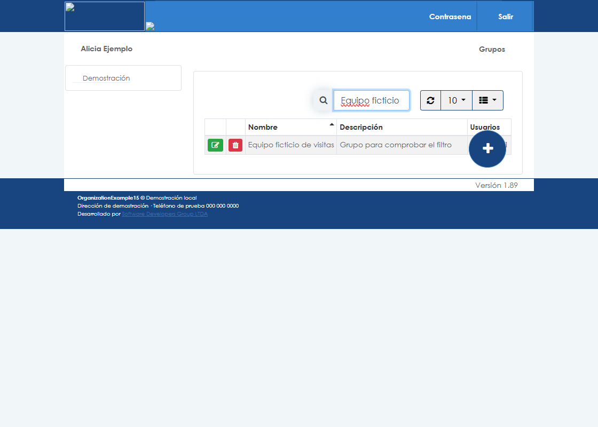

# Gestión de atención domiciliaria

[English](#english) · [Español](#español)

## English

Archived ASP.NET application for coordinating home visits, care teams and service records

> [!WARNING]
> **Status: Archived.** This snapshot preserves an earlier edition. Its build instructions identify the requirements and checks for this cut.

### Overview

Home-care teams can use the application to organise visits, refer to contact and service records, and coordinate the people who provide care.

### Features

- Record postpartum care and follow-up in the maternal care module. `OrganizationExample15/materna/postparto.aspx`.
- Consult the maternal care report. `OrganizationExample15/materna/informe.aspx`.
- Open the batch admission screen to process patient admissions. `OrganizationExample15/admisiones/amasivas.aspx`.
- Review visit scheduling from the census. `OrganizationExample15/censo/censo_programacion.aspx`.
- Review the list of therapeutic progress notes. `OrganizationExample15/terapeutico/evoluciones.aspx`.
- List discharges from the wound-care clinic. `OrganizationExample15/clinicaheridas/egresos.aspx`.
- Record the wound assessment in the clinical record. `OrganizationExample15/clinicaheridas/valoracion.aspx`.
- Consult and maintain wound progression notes. `OrganizationExample15/clinicaheridas/evolucion.aspx`.
- Open the patient record and its care information. `OrganizationExample15/paciente/paciente.aspx`.
- Open the staff record for the care team. `OrganizationExample15/rh/funcionario.aspx`.

### Requirements

Use Windows with .NET Framework 4.8, IIS Express and PowerShell 7 to build the archived Web Forms edition in the example. Its build script rebuilds the shared library and invokes the ASP.NET compiler. Use a disposable test database and fictional records.

### Getting started

To build and package both distributable MVC editions, run this from Developer PowerShell with Python 3. The script restores the pinned NuGet dependencies and invokes MSBuild Build for each edition. It writes the output to separate edition folders. Use `--edition` to select one edition.

```powershell
$mvcOutput = Join-Path $env:TEMP ('domicilio-mvc-' + [guid]::NewGuid().ToString('N'))
python demo/build-mvc.py --package-output $mvcOutput
```

The archived MVC projects target .NET Framework 4.6. From Developer PowerShell for Visual Studio, run `python demo/build-mvc.py` to compile their recovered C# source. The script restores pinned packages from NuGet and rebuilds the included shared library before compiling both projects. It uses separate Git exports. Run `python demo/run-mvc.py` with IIS Express and Docker to check sign-in in the default MVC edition. The demo creates its own local databases and a fictional notification server. It verifies that the fictional account can open `/Inicio` and that MySQL records the sign-in. The source build covers both MVC editions. Full packaging and the embedded legacy ASPX pages still require archived resources and separate verification. Prepare the pinned notification image and select the edition with these commands.

```powershell
docker pull python@sha256:5e2bdb1b0d542d5039cffb8181c65930093949194a65c365dfb1b0fe13a4fa5b
python demo/run-mvc.py --edition OrganizationExample15
python demo/run-mvc.py --edition OrganizationExample15.mvc.2018-11-21
```

The example uses the archived [10 November 2011 Web Forms edition](../../commit/0133c745fde25672d3e35392d44642c069800548). Install Python 3 and Docker in addition to the Windows tools above. Run the commands below from this checkout. The script exports the edition to a disposable folder and compiles it with its own build script.

```powershell
docker pull mysql@sha256:4bc6bc963e6d8443453676cae56536f4b8156d78bae03c0145cbe47c2aad73bb
docker pull mcr.microsoft.com/mssql/server@sha256:4525e3efac9f3e241cb003bb2ff2a82818b502f37e12049d788b1a9fa7e13b7f
python demo/run-webforms.py
```

### Usage

Use the documented local build with a fictional operator. The available screens include `OrganizationExample15/materna/postparto.aspx` and the other routes above.

The check signs in as `alicia_demo`, opens the protected home page and verifies the timestamp written to MySQL for the fictional operator. MySQL and SQL Server use isolated loopback ports and fictional tables. To open the demo in a browser after this check, set a fresh fictional password and keep the server running.

```powershell
$env:DOMICILIO_DEMO_PASSWORD = ([guid]::NewGuid().ToString('N')).Substring(0,16)
python demo/run-webforms.py --serve
```

Open the address printed by the script. Sign in with `alicia_demo` and the password you provided. Press Ctrl+C to stop and remove the test services.

### Verification

Four neutral theme textures are included byte for byte in both MVC editions. The two archived header images are withheld while their graphic provenance is unresolved.

Both MVC packages include the recovered blank workbook template used to export pages to Excel. The template contains formatting and workbook structure. The demonstration data comes from the disposable test database.

The MVC package includes the recovered browser-library graphics. The local walkthrough uses fictional records and excludes patient material, retired Flash assets and application graphics whose origin is undetermined.

The two MVC layouts load the original archived jQuery 3.3.1 file from the repository. It supplies the browser-side interaction used by the group filter.

Each MVC demo also opens the group administration page, filters its group list and confirms that the group for the fictional visit team comes from MySQL.

The 21 November 2026 browser check loaded jQuery 3.3.1 in both MVC editions and entered `Equipo ficticio` in the actual search field. Each request returned HTTP 200 and the table displayed the fictional visit team. The first edition is shown below.



On 21 November 2026, MSBuild packaged both MVC editions. The export test called the packaged Excel exporter with a fictional MySQL row in each edition, then read the resulting workbook and verified that row. The test covers the exporter and template. The full browser workflow for every export remains unverified.

The original MVC content lists have 88 and 85 omitted entries. Wound care, maternal care, pharmacy and webcam demonstrations require separate fictional material. The original Flash widgets remain outside the current browser test. Some archived images need independently identified artwork or a copy matched to this edition. Local configuration, menus and table definitions for the tested routes come from the disposable recipe.

The distributable project keeps the archived list of content. MSBuild includes those historical files when they are present. The checkout omits archived records, unreleased visual assets, live configuration and files that could not be paired with this edition. The demo supplies a loopback configuration, a fictional directory and a clean migration list. Other modules may require their own safe fixtures or replacement artwork.

The two MVC source compilations passed on 20 November 2026 with Python 3.12.4 and MSBuild 18.11.1.51303. The Web Forms demo used Docker 29.9.2.

The trial on 20 November 2026 used Windows 11 build 26300, PowerShell 7.6.9, .NET SDK 11.0.100, IIS Express 10.0.26013.1000 and ASP.NET Compilation Tool 4.8.10001.0. The images show the original Web Forms sign-in and the protected home page for Alicia Ejemplo. Some historical artwork is absent in that edition. The test covers the sign-in and home page. Visit scheduling and external integrations require separate tests.


### Project structure

`OrganizationExample15/` and `OrganizationExample15.mvc.2018-11-21/` contain the MVC editions. `OrganizationExample15.webforms/` contains the Web Forms site. `OrganizationExample16/` contains another archived edition. `movil/` and `movil.no/` contain the mobile pages and an earlier variant. `vendor/` contains the recovered shared library and package project files. `demo/` holds the fictional example.

### History

This repository combines the archived web editions and keeps their recorded Git dates.The 2026 reconstruction brings the recovered archive snapshots into one timeline. The May and August 2011 cuts remain as source archives with incomplete build inputs.

### Contributing

Keep local settings and fictional test data in a disposable copy. Report the exact edition and steps that reproduce the change.

### Support

Use the repository’s issues to report a reproducible build problem or a missing resource.

### License

The application’s own code is available under the [MIT license](LICENSE). Included third-party files retain their original notices.

---

## Español

Aplicación ASP.NET archivada para coordinar visitas domiciliarias, equipos de atención y registros del servicio

> [!WARNING]
> **Estado: archivado.** Esta copia conserva una edición anterior. Sus instrucciones de compilación indican los requisitos y las pruebas de este corte.

Aplicación ASP.NET para coordinar visitas domiciliarias, equipos de atención y registros del servicio


### Descripción general

Los equipos de atención domiciliaria pueden organizar visitas, consultar fichas de contacto y de servicio y coordinar al personal que presta la atención.

### Funciones

- Registra la atención posparto y su seguimiento en el módulo materno. `OrganizationExample15/materna/postparto.aspx`.
- Consulta el informe de atención materna. `OrganizationExample15/materna/informe.aspx`.
- Abre la pantalla de admisiones masivas para procesar ingresos de pacientes. `OrganizationExample15/admisiones/amasivas.aspx`.
- Consulta la programación de visitas desde el censo. `OrganizationExample15/censo/censo_programacion.aspx`.
- Consulta el listado de notas de evolución terapéutica. `OrganizationExample15/terapeutico/evoluciones.aspx`.
- Consulta los egresos de la clínica de heridas. `OrganizationExample15/clinicaheridas/egresos.aspx`.
- Registra la valoración de heridas en la ficha clínica. `OrganizationExample15/clinicaheridas/valoracion.aspx`.
- Consulta y actualiza las notas de evolución de heridas. `OrganizationExample15/clinicaheridas/evolucion.aspx`.
- Abre la ficha del paciente y su información de atención. `OrganizationExample15/paciente/paciente.aspx`.
- Abre la ficha del personal del equipo de atención. `OrganizationExample15/rh/funcionario.aspx`.

### Requisitos

Usa Windows con .NET Framework 4.8, IIS Express y PowerShell 7 para compilar la edición Web Forms del ejemplo. El script recompila la biblioteca compartida y ejecuta el compilador de ASP.NET. Usa una base desechable y registros ficticios.

### Cómo empezar

Para compilar y empaquetar ambas ediciones MVC distribuibles, ejecuta esto en Developer PowerShell con Python 3. El script restaura las dependencias fijadas de NuGet y ejecuta MSBuild Build para cada edición. Deja el resultado en carpetas separadas. Usa `--edition` para elegir una edición.

```powershell
$mvcOutput = Join-Path $env:TEMP ('domicilio-mvc-' + [guid]::NewGuid().ToString('N'))
python demo/build-mvc.py --package-output $mvcOutput
```

Los proyectos MVC archivados apuntan a .NET Framework 4.6. Desde Developer PowerShell para Visual Studio, ejecuta `python demo/build-mvc.py` para compilar las fuentes C# recuperadas. El programa restaura los paquetes fijados en NuGet y recompila la biblioteca compartida antes de compilar ambos proyectos. Usa exportaciones Git separadas. Ejecuta `python demo/run-mvc.py` con IIS Express y Docker para comprobar el ingreso de la edición MVC predeterminada. La demo crea sus propias bases locales y un servidor de notificaciones ficticio. Comprueba que la cuenta ficticia abre `/Inicio` y que MySQL registra el ingreso. La compilación de fuentes abarca las dos ediciones MVC. El empaquetado completo y las páginas ASPX heredadas requieren recursos del respaldo y pruebas aparte. Prepara la imagen de notificaciones fijada y selecciona la edición con estos comandos.

```powershell
docker pull python@sha256:5e2bdb1b0d542d5039cffb8181c65930093949194a65c365dfb1b0fe13a4fa5b
python demo/run-mvc.py --edition OrganizationExample15
python demo/run-mvc.py --edition OrganizationExample15.mvc.2018-11-21
```

El ejemplo usa la [edición Web Forms del 10 de noviembre de 2011](../../commit/0133c745fde25672d3e35392d44642c069800548). Instala Python 3 y Docker además de las herramientas de Windows indicadas arriba. Ejecuta estos comandos desde esta copia. El script exporta la edición a una carpeta desechable y la compila con su propio script.

```powershell
docker pull mysql@sha256:4bc6bc963e6d8443453676cae56536f4b8156d78bae03c0145cbe47c2aad73bb
docker pull mcr.microsoft.com/mssql/server@sha256:4525e3efac9f3e241cb003bb2ff2a82818b502f37e12049d788b1a9fa7e13b7f
python demo/run-webforms.py
```

### Uso

Usa la compilación local documentada con un operador ficticio. Las pantallas disponibles incluyen `OrganizationExample15/materna/postparto.aspx` y las demás rutas de arriba.

La comprobación entra con `alicia_demo`, abre la portada protegida y verifica la fecha de ingreso que MySQL registró para la operadora ficticia. MySQL y SQL Server usan puertos locales separados y tablas ficticias. Para abrir la demo en el navegador después de esta comprobación, genera una contraseña ficticia y deja el servidor en marcha.

```powershell
$env:DOMICILIO_DEMO_PASSWORD = ([guid]::NewGuid().ToString('N')).Substring(0,16)
python demo/run-webforms.py --serve
```

Abre la dirección que muestra el script. Ingresa con `alicia_demo` y la contraseña que elegiste. Pulsa Ctrl+C para retirar los servicios de prueba.

### Verificación

Ambas ediciones MVC incluyen cuatro texturas neutras del respaldo, byte a byte. Las dos imágenes históricas de cabecera quedan en reserva hasta confirmar su procedencia gráfica.

Ambos paquetes MVC incluyen la plantilla de libro en blanco que usa la aplicación para exportar páginas a Excel. La plantilla contiene el formato y la estructura del libro. Los datos de demostración provienen de la base desechable de prueba.

El paquete MVC incluye los gráficos recuperados de las bibliotecas web. El recorrido local usa datos ficticios y excluye material de pacientes, componentes Flash retirados y gráficos de la aplicación cuyo origen queda por determinar.

Los dos diseños MVC cargan desde el repositorio el archivo original de jQuery 3.3.1 de sus respaldos. La usa el filtro de grupos para funcionar en el navegador.

La demo de cada edición MVC también abre la administración de grupos, filtra la lista y comprueba que MySQL devuelve el grupo del equipo ficticio de visitas.

La prueba del 21 de noviembre de 2026 cargó jQuery 3.3.1 en el navegador en ambas ediciones MVC y escribió `Equipo ficticio` en el campo de búsqueda. Cada petición devolvió HTTP 200 y la tabla mostró el equipo ficticio de visitas. La captura corresponde a la primera edición.


El 21 de noviembre de 2026, MSBuild empaquetó las dos ediciones MVC. La prueba llamó al exportador de Excel del paquete con una fila de MySQL ficticio por edición, volvió a abrir el libro y comprobó esa fila. El ensayo cubrió el exportador y su plantilla. Queda por verificar el recorrido completo de cada exportación desde el navegador.

Las listas originales de contenido MVC tienen 88 y 85 entradas omitidas. Las demos de heridas, atención materna, farmacia y cámara requieren material ficticio propio. Los componentes Flash históricos quedan fuera de la prueba en el navegador actual. Algunos gráficos necesitan una procedencia identificada o una copia cotejada con esta edición. La receta desechable aporta la configuración local, los menús y las tablas para las rutas probadas.

El proyecto distribuible conserva la lista de contenido del respaldo. MSBuild incorpora esos archivos cuando están presentes. La copia omite registros archivados, recursos visuales sin revisión, configuración real y archivos que no se pudieron emparejar con la edición. La demo aporta la configuración local, un directorio ficticio y una lista de migraciones vacía. Otros módulos pueden requerir sus propios datos de prueba o imágenes de reemplazo.

Las dos compilaciones de fuentes MVC pasaron el 20 de noviembre de 2026 con Python 3.12.4 y MSBuild 18.11.1.51303. La demo Web Forms usó Docker 29.9.2.

La prueba del 20 de noviembre de 2026 usó Windows 11, compilación 26300, PowerShell 7.6.9, SDK de .NET 11.0.100, IIS Express 10.0.26013.1000 y ASP.NET Compilation Tool 4.8.10001.0. Las imágenes muestran el formulario original de ingreso y la portada protegida para Alicia Ejemplo. Faltan algunas imágenes de esa edición. La prueba cubre el ingreso y la portada. La agenda de visitas y las integraciones externas requieren pruebas aparte.


### Estructura del proyecto

`OrganizationExample15/` y `OrganizationExample15.mvc.2018-11-21/` contienen las ediciones MVC. `OrganizationExample15.webforms/` contiene el sitio Web Forms. `OrganizationExample16/` contiene otra edición archivada. `movil/` y `movil.no/` contienen las páginas móviles y una variante anterior. `vendor/` contiene la biblioteca compartida recuperada y los archivos de proyecto de sus paquetes. `demo/` guarda el ejemplo ficticio.

### Historia

Este repositorio reúne las ediciones web archivadas y conserva las fechas registradas en Git. El historial principal conserva las demás ediciones archivadas.

### Contribuir

Mantén la configuración local y los datos ficticios en una copia desechable. Indica la edición exacta y los pasos para reproducir el cambio.

### Soporte

Usa los issues del repositorio para reportar un problema de compilación reproducible o un recurso que falte.

### Licencia

El código propio de la aplicación usa la [licencia MIT](LICENSE). Los archivos de terceros conservan sus avisos originales.
