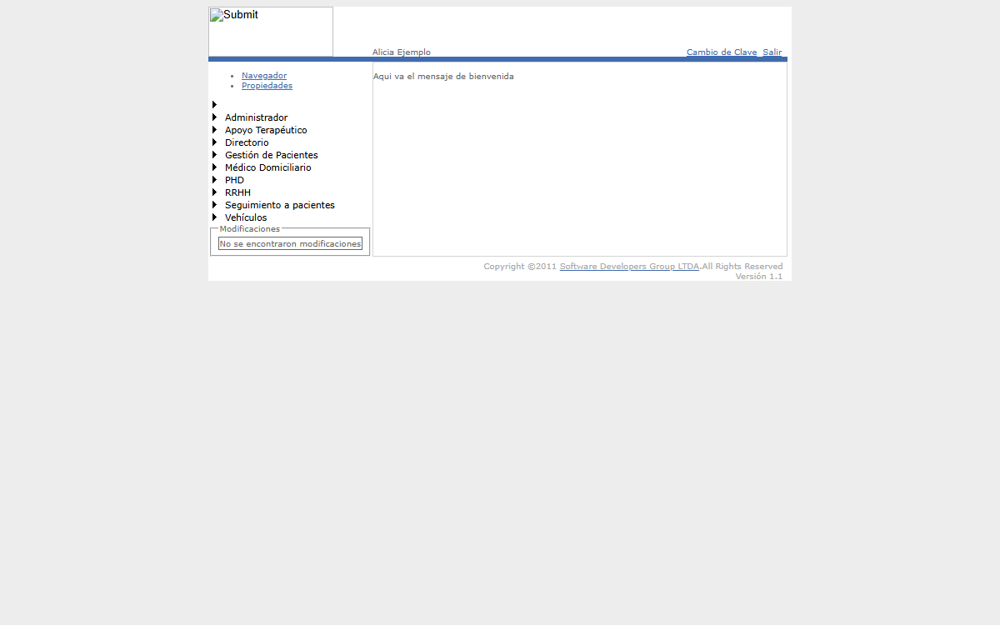
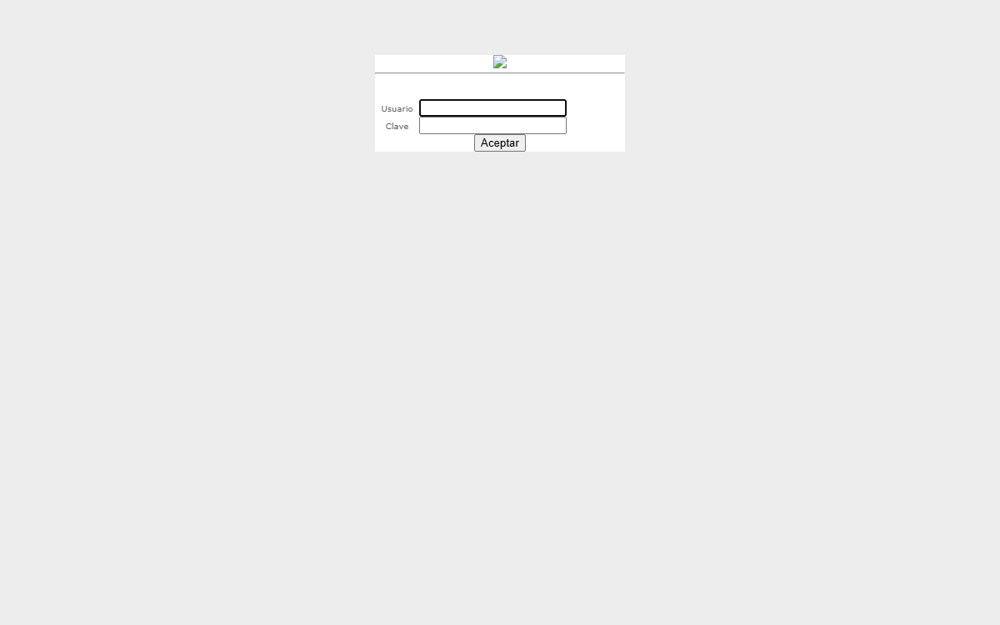

# Gestión de atención domiciliaria

[English](#english) · [Español](#español)

## English

Archived ASP.NET application for coordinating home visits, care teams and service records

> [!WARNING]
> **Status: Archived.** This snapshot preserves an earlier edition. Its build instructions identify the requirements and checks for this cut.

### Overview

Home-care teams can use the application to organise visits, refer to contact and service records, and coordinate the people who provide care.

### Features

- Record postpartum care and follow-up in the maternal care module. `OrganizationExample15/materna/postparto.aspx`.
- Consult the maternal care report. `OrganizationExample15/materna/informe.aspx`.
- Open the batch admission screen to process patient admissions. `OrganizationExample15/admisiones/amasivas.aspx`.
- Review visit scheduling from the census. `OrganizationExample15/censo/censo_programacion.aspx`.
- Review the list of therapeutic progress notes. `OrganizationExample15/terapeutico/evoluciones.aspx`.
- List discharges from the wound-care clinic. `OrganizationExample15/clinicaheridas/egresos.aspx`.
- Record the wound assessment in the clinical record. `OrganizationExample15/clinicaheridas/valoracion.aspx`.
- Consult and maintain wound progression notes. `OrganizationExample15/clinicaheridas/evolucion.aspx`.
- Open the patient record and its care information. `OrganizationExample15/paciente/paciente.aspx`.
- Open the staff record for the care team. `OrganizationExample15/rh/funcionario.aspx`.

### Requirements

Use Windows with .NET Framework 4.8, IIS Express and PowerShell 7 to build the archived Web Forms edition in the example. Its build script rebuilds the shared library and invokes the ASP.NET compiler. Use a disposable test database and fictional records.

### Getting started

The archived MVC projects target .NET Framework 4.6. The complete web build of those projects remains under verification.

The example uses the archived [10 November 2011 Web Forms edition](../../commit/0133c745fde25672d3e35392d44642c069800548). Install Python 3 and Docker in addition to the Windows tools above. Run the commands below from this checkout. The script exports the edition to a disposable folder and compiles it with its own build script.

```powershell
docker pull mysql@sha256:4bc6bc963e6d8443453676cae56536f4b8156d78bae03c0145cbe47c2aad73bb
docker pull mcr.microsoft.com/mssql/server@sha256:4525e3efac9f3e241cb003bb2ff2a82818b502f37e12049d788b1a9fa7e13b7f
python demo/run-webforms.py
```

### Usage

Use the documented local build with a fictional operator. The available screens include `OrganizationExample15/materna/postparto.aspx` and the other routes above.

The check signs in as `alicia_demo`, opens the protected home page and verifies the timestamp written to MySQL for the fictional operator. MySQL and SQL Server use isolated loopback ports and fictional tables. To open the demo in a browser after this check, set a fresh fictional password and keep the server running.

```powershell
$env:DOMICILIO_DEMO_PASSWORD = ([guid]::NewGuid().ToString('N')).Substring(0,16)
python demo/run-webforms.py --serve
```

Open the address printed by the script. Sign in with `alicia_demo` and the password you provided. Press Ctrl+C to stop and remove the test services.

### Verification

The trial on 20 November 2026 used Windows 11 build 26300, PowerShell 7.6.9, .NET SDK 11.0.100, IIS Express 10.0.26013.1000 and ASP.NET Compilation Tool 4.8.10001.0. The images show the original Web Forms sign-in and the protected home page for Alicia Ejemplo. Some historical artwork is absent in that edition. The test covers the sign-in and home page. Visit scheduling and external integrations require separate tests.





### Project structure

`OrganizationExample15/` and `OrganizationExample15.mvc.2018-11-21/` contain the MVC editions. `OrganizationExample15.webforms/` contains the Web Forms site. `OrganizationExample16/` contains another archived edition. `movil/` and `movil.no/` contain the mobile pages and an earlier variant. `demo/` holds the fictional example.

### History

This repository combines the archived web editions and keeps their recorded Git dates.The 2026 reconstruction brings the recovered archive snapshots into one timeline. The May and August 2011 cuts remain as source archives with incomplete build inputs.

### Contributing

Keep local settings and fictional test data in a disposable copy. Report the exact edition and steps that reproduce the change.

### Support

Use the repository’s issues to report a reproducible build problem or a missing resource.

### License

The application’s own code is available under the [MIT license](LICENSE). Included third-party files retain their original notices.

---

The local build precompiles the remaining Web Forms pages. The build recipe excludes pages that depend on archived controls that have not survived. The runtime test only checks local sign-in with a fictional account. It does not exercise the excluded pages, clinical forms, or external integrations. The 10 file exclusions in `demo/missing-controls.json` include `paciente/ingreso.aspx`, `paciente/ingreso.aspx.cs`, `paciente/evolucion.aspx`, `paciente/evolucion.aspx.cs`.

## Español

Aplicación ASP.NET archivada para coordinar visitas domiciliarias, equipos de atención y registros del servicio

> [!WARNING]
> **Estado: archivado.** Esta copia conserva una edición anterior. Sus instrucciones de compilación indican los requisitos y las pruebas de este corte.

Aplicación ASP.NET para coordinar visitas domiciliarias, equipos de atención y registros del servicio


### Descripción general

Los equipos de atención domiciliaria pueden organizar visitas, consultar fichas de contacto y de servicio y coordinar al personal que presta la atención.

### Funciones

- Registra la atención posparto y su seguimiento en el módulo materno. `OrganizationExample15/materna/postparto.aspx`.
- Consulta el informe de atención materna. `OrganizationExample15/materna/informe.aspx`.
- Abre la pantalla de admisiones masivas para procesar ingresos de pacientes. `OrganizationExample15/admisiones/amasivas.aspx`.
- Consulta la programación de visitas desde el censo. `OrganizationExample15/censo/censo_programacion.aspx`.
- Consulta el listado de notas de evolución terapéutica. `OrganizationExample15/terapeutico/evoluciones.aspx`.
- Consulta los egresos de la clínica de heridas. `OrganizationExample15/clinicaheridas/egresos.aspx`.
- Registra la valoración de heridas en la ficha clínica. `OrganizationExample15/clinicaheridas/valoracion.aspx`.
- Consulta y actualiza las notas de evolución de heridas. `OrganizationExample15/clinicaheridas/evolucion.aspx`.
- Abre la ficha del paciente y su información de atención. `OrganizationExample15/paciente/paciente.aspx`.
- Abre la ficha del personal del equipo de atención. `OrganizationExample15/rh/funcionario.aspx`.

### Requisitos

Usa Windows con .NET Framework 4.8, IIS Express y PowerShell 7 para compilar la edición Web Forms del ejemplo. El script recompila la biblioteca compartida y ejecuta el compilador de ASP.NET. Usa una base desechable y registros ficticios.

### Cómo empezar

Los proyectos MVC archivados apuntan a .NET Framework 4.6. La compilación web completa de esos proyectos sigue en verificación.

El ejemplo usa la [edición Web Forms del 10 de noviembre de 2011](../../commit/0133c745fde25672d3e35392d44642c069800548). Instala Python 3 y Docker además de las herramientas de Windows indicadas arriba. Ejecuta estos comandos desde esta copia. El script exporta la edición a una carpeta desechable y la compila con su propio script.

```powershell
docker pull mysql@sha256:4bc6bc963e6d8443453676cae56536f4b8156d78bae03c0145cbe47c2aad73bb
docker pull mcr.microsoft.com/mssql/server@sha256:4525e3efac9f3e241cb003bb2ff2a82818b502f37e12049d788b1a9fa7e13b7f
python demo/run-webforms.py
```

### Uso

Usa la compilación local documentada con un operador ficticio. Las pantallas disponibles incluyen `OrganizationExample15/materna/postparto.aspx` y las demás rutas de arriba.

La comprobación entra con `alicia_demo`, abre la portada protegida y verifica la fecha de ingreso que MySQL registró para la operadora ficticia. MySQL y SQL Server usan puertos locales separados y tablas ficticias. Para abrir la demo en el navegador después de esta comprobación, genera una contraseña ficticia y deja el servidor en marcha.

```powershell
$env:DOMICILIO_DEMO_PASSWORD = ([guid]::NewGuid().ToString('N')).Substring(0,16)
python demo/run-webforms.py --serve
```

Abre la dirección que muestra el script. Ingresa con `alicia_demo` y la contraseña que elegiste. Pulsa Ctrl+C para retirar los servicios de prueba.

### Verificación

La prueba del 20 de noviembre de 2026 usó Windows 11, compilación 26300, PowerShell 7.6.9, SDK de .NET 11.0.100, IIS Express 10.0.26013.1000 y ASP.NET Compilation Tool 4.8.10001.0. Las imágenes muestran el formulario original de ingreso y la portada protegida para Alicia Ejemplo. Faltan algunas imágenes de esa edición. La prueba cubre el ingreso y la portada. La agenda de visitas y las integraciones externas requieren pruebas aparte.


### Estructura del proyecto

`OrganizationExample15/` y `OrganizationExample15.mvc.2018-11-21/` contienen las ediciones MVC. `OrganizationExample15.webforms/` contiene el sitio Web Forms. `OrganizationExample16/` contiene otra edición archivada. `movil/` y `movil.no/` contienen las páginas móviles y una variante anterior. `demo/` guarda el ejemplo ficticio.

### Historia

Este repositorio reúne las ediciones web archivadas y conserva las fechas registradas en Git. El historial principal conserva las demás ediciones archivadas.

### Contribuir

Mantén la configuración local y los datos ficticios en una copia desechable. Indica la edición exacta y los pasos para reproducir el cambio.

### Soporte

Usa los issues del repositorio para reportar un problema de compilación reproducible o un recurso que falte.

### Licencia

El código propio de la aplicación usa la [licencia MIT](LICENSE). Los archivos de terceros conservan sus avisos originales.

## Recovered local build / Compilación local recuperada

The recovered Web Forms site is in `OrganizationExample15.webforms`. Run `pwsh -NoProfile -File demo/Build.ps1 -Output <new-directory>` on Windows with .NET Framework 4.8 and the .NET SDK. The build compiles the compatible shared library from the recovered sources and uses the sample Web.config in the copy.

El sitio Web Forms recuperado se encuentra en `OrganizationExample15.webforms`. Ejecuta `pwsh -NoProfile -File demo/Build.ps1 -Output <carpeta-nueva>` en Windows con .NET Framework 4.8 y el SDK de .NET. La compilación compila la biblioteca propia compatible desde las fuentes recuperadas y usa Web.config de ejemplo en la copia.

The build restores iTextSharp 5.4.4 from the official NuGet package and checks its SHA-256. Set `DOMICILIO_ITEXTSHARP_PACKAGE` to the same package for an offline build.

La compilación restaura iTextSharp 5.4.4 desde el paquete oficial de NuGet y coteja su SHA-256. Indica una copia del mismo paquete en `DOMICILIO_ITEXTSHARP_PACKAGE` para compilar sin Internet.

The 2026 reconstruction restores archived Web Forms inputs and builds the compatible February 2016 copy of the owned shared library. The recipe excludes tracked views with missing patient controls from its disposable build. The fictional MySQL test verified sign-in and the protected home page with the historical grouping mode.

La reconstrucción de 2026 recupera insumos archivados de Web Forms y compila la copia compatible de febrero de 2016 de la biblioteca propia. La receta aparta de la copia desechable las vistas que requieren controles de paciente ausentes. La prueba con MySQL ficticio verificó el ingreso y la portada protegida con el modo histórico de agrupación.

La compilación local precompila las páginas Web Forms disponibles. La receta excluye las páginas que dependen de controles históricos que no se conservaron. La prueba de ejecución cubre solo el ingreso local con una cuenta ficticia. Quedan sin probar las páginas excluidas, los formularios clínicos y las integraciones externas. Las 10 exclusiones de archivos de `demo/missing-controls.json` incluyen `paciente/ingreso.aspx`, `paciente/ingreso.aspx.cs`, `paciente/evolucion.aspx`, `paciente/evolucion.aspx.cs`.

